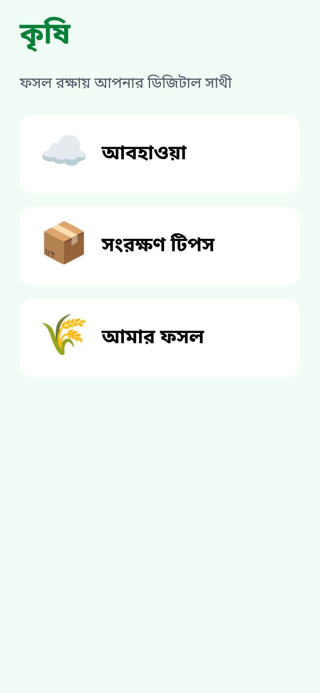
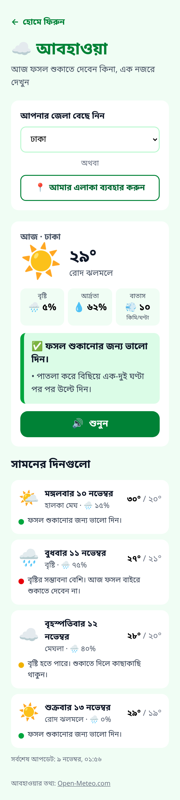
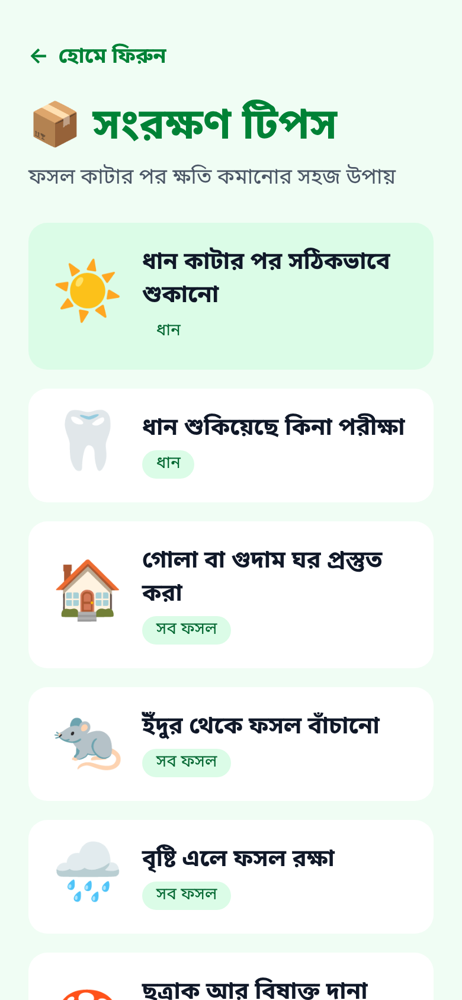
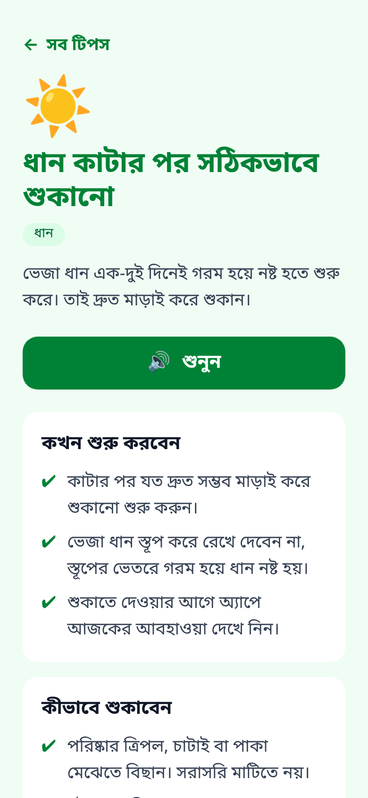

# কৃষি (Krishi): crop-loss helper for Bangladeshi farmers

A Bangla-first, mobile-first web app that helps farmers in Bangladesh **lose less of their harvest after it is cut**: it tells them, in plain Bangla, whether today is safe to dry their crop outside, and gives simple storage tips they can **listen to** instead of read.

> Live demo: _add your Vercel link here_

<p>
  
  
  
  
</p>

<sub>Screenshots use sample forecast data.</sub>

## The problem

A large share of grain in Bangladesh is lost **after** harvest: paddy left wet for a day starts to heat and rot, a sudden shower soaks a courtyard full of drying rice, rats and mould get into poorly stored sacks. Most of these losses are preventable with two things: knowing the weather for the next few days, and knowing a few storage basics.

The people who need this most are smallholder farmers. Many use cheap Android phones on slow connections, and many find reading long text hard. So the app is designed around them, not around a typical web user.

## Features

| Feature | What the farmer sees |
| --- | --- |
| **Drying advice from a live forecast** | Pick your district (all 64) or tap "আমার এলাকা" to use GPS. Get a 5-day forecast and a clear verdict for each day: ✅ good day to dry, ⚠️ rain possible, ⛔ don't dry today. |
| **🔊 Listen instead of read** | Every tip and today's weather advice can be read aloud in Bangla using the browser's built-in speech engine. No server, no cost. |
| **Works on a weak connection** | The last forecast is saved on the phone. With no internet it is still shown, clearly marked, with a retry button. The Bangla font ships with the app instead of loading from a CDN. |
| **Storage tips** | 7 short, practical guides: drying paddy, checking dryness with the teeth and salt-bottle tests, preparing the store, rats, rain, mould, potatoes. |
| **No sign-up needed** | Weather and tips work without an account. Login is only planned for personal crop records. |

## Designed for low-literacy users

- **Pictures before words**: every card leads with a big emoji, so the screen can be understood at a glance.
- **Big touch targets**: buttons and links are at least 48–56 px tall.
- **Plain Bangla, Bangla digits and dates**: "বৃষ্টির সম্ভাবনা বেশি। আজ ফসল বাইরে শুকাতে দেবেন না।" instead of "Precipitation probability 75%".
- **Pick, don't type**: districts come from a list grouped by division, or from GPS.
- **Mobile-first layout**: a single phone-width column, centred on larger screens.
- **Cautious by design**: when the rules are unsure, the advice errs on the side of "don't dry today", and every tip reminds farmers to confirm with their local agriculture officer.

## How the drying advice works

The forecast comes from [Open-Meteo](https://open-meteo.com) (free, no API key, so there are no secrets in the frontend). The raw numbers are turned into advice by a small, tested rule set in [`src/lib/advice.ts`](src/lib/advice.ts):

| Condition | Verdict |
| --- | --- |
| Rain chance ≥ 60% **or** rain ≥ 5 mm | ⛔ Don't dry outside today |
| Rain chance ≥ 30% | ⚠️ Rain possible, stay close |
| Daytime humidity ≥ 85% | ⚠️ Drying will be slow |
| Otherwise | ✅ Good day to dry |
| Wind ≥ 40 km/h / max temp ≥ 36 °C | Extra tips: weigh down covers / heat safety |

Humidity is averaged over **daytime hours (6 am – 6 pm)** only, because that is when crops are dried; night-time humidity would make every day look bad.

## Tech stack

- **React 19 + TypeScript + Vite**
- **Tailwind CSS v4** for styling
- **React Router** for pages (`/`, `/weather`, `/tips`, `/tips/:slug`, 404)
- **Open-Meteo API** with `fetch` + `AbortController` (stale requests are cancelled when the district changes)
- **Web Speech API** for Bangla text-to-speech
- **Vitest** unit tests for the advice rules, API parsing, Bangla number formatting and GPS-to-district lookup
- Deployed on **Vercel** (`vercel.json` rewrites all routes to the SPA)

## Project structure

```
src/
├── App.tsx                 routes
├── pages/                  one file per screen
│   ├── HomePage.tsx
│   ├── WeatherPage.tsx
│   ├── TipsPage.tsx
│   ├── TipDetailPage.tsx
│   ├── MyCropsPage.tsx     (coming soon)
│   └── NotFoundPage.tsx
├── components/             reusable UI: Layout, HomeCard, BackLink, SpeakButton,
│                           LocationPicker, TodayCard, ForecastRow
├── hooks/useForecast.ts    fetching + offline cache
├── lib/                    weather API, advice rules, Bangla formatting, storage
└── data/                   64 districts, storage tips
```

## Rebuilding it properly

This is a rewrite of an earlier prototype I generated with an AI website builder. Reviewing that version taught me what to fix:

| Old prototype | This version |
| --- | --- |
| Weather API key was a placeholder, so every request failed and **random numbers were shown as a real forecast** | Real forecast from Open-Meteo; if it fails the user is told, and the last real forecast is shown |
| Farmer passwords stored in plain text in `localStorage` | No accounts yet; login will use Supabase Auth with Row Level Security |
| A database table readable and writable by anyone (`USING (true)` RLS policies) | Removed; security will be designed per table |
| `.env` committed to GitHub | `.env` in `.gitignore` from the first commit |
| Articles rendered with `dangerouslySetInnerHTML` | Tips are plain typed data rendered as React elements |
| 49 UI component files, ~15 used; `<a href>` links that reloaded the app | Only what is used; client-side `Link` navigation |

I built the project foundation (Vite setup, routing, layout and components) step by step while learning React, and developed the weather and tips features with an AI pair-programmer.

## Run it locally

```bash
git clone https://github.com/badhan7700/krishi.git
cd krishi
npm install
npm run dev      # http://localhost:5173
npm test         # unit tests
npm run build    # type-check + production build
```

No environment variables are needed.

## Roadmap

- [ ] **My crops**: log crop batches in মণ (maund), storage place, and losses with reasons. Login with mobile number + PIN (Supabase Auth + RLS so each farmer sees only their own data)
- [ ] **Photo diagnosis**: take a photo of stored grain or a leaf and get a likely problem and next steps (AI, through a server function so the key stays secret)
- [ ] **Ask by voice**: ask a question in spoken Bangla and hear the answer
- [ ] **Personal alerts**: "you have 40 মণ in storage and heavy rain is coming in 2 days"
- [ ] Installable PWA with full offline support

## Credits

Weather data by [Open-Meteo.com](https://open-meteo.com/) (CC BY 4.0). Font: Noto Sans Bengali.
